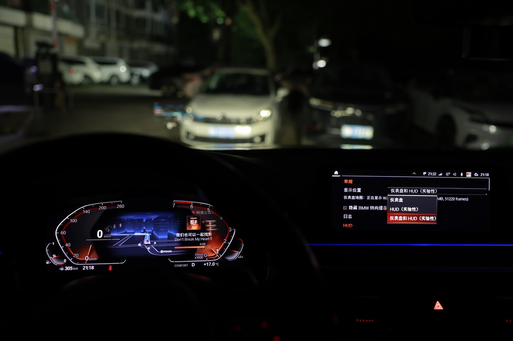
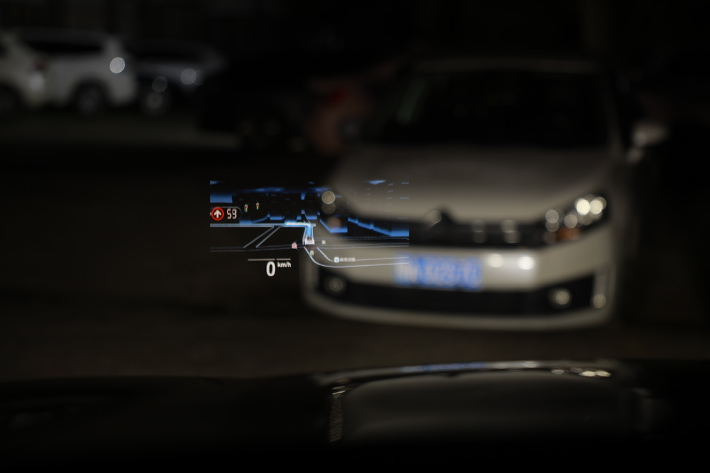
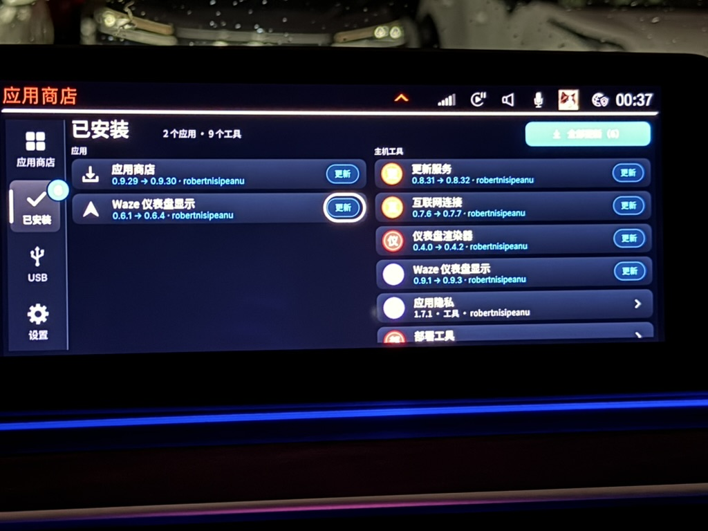

# idrive-apps

[English](README.md) | 简体中文

适用于宝马 iDrive 7 车机（MGU）的工具和应用，通过
[mgu Store](https://github.com/robertnisipeanu/mgu-store) 安装。

| 路径 | 说明 |
|---|---|
| [`native/cluster-render`](native/cluster-render) | 仪表盘渲染器：由一个服务在仪表盘和 HUD 上绘制各个应用的图层，支持 iDrive 7 和 iDrive 8 |
| [`native/waze-on-cluster`](native/waze-on-cluster) | 通过 cluster-render，将 CarPlay 地图（Waze、苹果地图或谷歌地图）或 Android Auto 地图显示在仪表盘上 |
| [`apps/robertn_waze_cluster`](apps/robertn_waze_cluster) | 对应的 iDrive 应用：为 CarPlay 和 Android Auto 应用或移除补丁，查看状态和日志 |
| [`release`](release) | 构建并发布商店目录 |
| `tools` | `oap_pack.js`、`oap_link.js`：应用打包工具 |

## 在 HUD 上显示地图

应用中的**显示位置**可以选择仪表盘（默认）、**HUD（实验性）**，
或**仪表盘和 HUD（实验性）**。同时显示时，HUD 按实际需要占用上传带宽，
最多使用一半，为两个显示区域保留流畅显示所需的带宽。
HUD 支持由 [eroobeeroo](https://github.com/eroobeeroo) 和
[wesleyredhat](https://github.com/wesleyredhat) 贡献。
以下照片来自一辆 2021 年款 X5 xDrive45e（G05），街道名称已模糊处理。


*HUD 上显示路线、前方街道和车速。右下角显示电池功率和温度的面板来自另一个应用。*

| 处理前：Waze 夜间地图的灰蓝色背景 | 处理后：背景变为黑色，在 HUD 上不显示 |
|---|---|
|  |  |

- **大小**：以 5% 为步长，在 HUD 宽度的 30% 到 85% 之间调整，
  保持画面宽高比。标准大小为适配后的显示区域，约占宽度的 57%。
- **位置**：使用**左移、右移、上移、下移**，每次移动 10 像素，
  或选择**居中**。调整立即生效，地图保持在 HUD 显示范围内。
- **适配 HUD**：在车机上将画面缩放到显示尺寸，每秒最多处理 10 帧，
  并添加圆角。夜间地图背景会变为黑色，让道路、路线和文字浮现在视野中；
  公园等绿色区域会保留。
- **避让原生内容**：HUD 原生媒体或列表弹窗出现时，地图会让出显示区域，
  不会替换宝马原生 HUD 内容。
- **错误保护**：如果仪表盘在 HUD 地图出现后立即重启，且连续发生两次，
  HUD 地图会保持关闭（`HUD map: Disabled after errors`，即因错误停用），
  直到更新到下一版 cluster-render 或执行 `cluster-render guard-reset`。
  仪表盘地图仍可继续使用。

在仪表盘上，地图填充中央区域：


### 中文界面与实车效果

以下照片由 [Wallezy](https://github.com/Wallezy) 提供，展示中文界面、
仪表盘地图和 HUD 的实车效果。照片中的版本号和安装状态仅代表拍摄时的情况，
不是当前发布版本，也不代表所有车型、固件或地图应用都具有相同效果。

显示位置设置与仪表盘地图：



HUD 地图：



商店中的中文应用和组件名称：



## 安装

在商店中添加 GitHub 来源 `robertnisipeanu/idrive-apps`，然后安装
**Waze on cluster**（中文界面为 **Waze 仪表盘显示**）。
商店会先安装所需依赖：来自 mgu-store 的 `mgu-deploy` 0.7.11，
然后是本仓库的 `cluster-render` 和 Waze 工具。
重启车机一次后，CarPlay 补丁生效；支持 Android Auto 的车辆也会激活对应补丁。
移除同样通过商店完成，顺序为应用、工具、渲染器。

## 构建

```sh
make -C native/cluster-render test test-x86 target    # host tests; the unit's toolchain and binary (Docker)
make -C native/waze-on-cluster test test-x86 target
node apps/robertn_waze_cluster/tools/test_control.js
node apps/robertn_waze_cluster/tools/test_page.js
node apps/robertn_waze_cluster/tools/test_i18n.js
node release/test/release_test.js
node release/release.js check                         # reproducible artifacts
```

各文件夹的 README 提供详细说明。
[`release/README.md`](release/README.md) 介绍版本、商店目录和发布流程。
提交 PR 前，请阅读 [`CONTRIBUTING.md`](CONTRIBUTING.md)：
版本号由发布流程设置。

## 许可证

除文件中的 SPDX 标头另有说明外，采用 GPL-3.0-or-later（[`LICENSE`](LICENSE)）。
供应用编译或复制使用的 cluster-render 部分，即 `include/`、`client/`、`kit/`、
`js/cluster_render_client.js` 和 `PROTOCOL.md`，采用
MPL-2.0（[`LICENSES/MPL-2.0.txt`](LICENSES/MPL-2.0.txt)）。
第三方文件保留各自的许可证：cluster-render 中的 RAMSES 和 vsomeip 接口
采用 MPL-2.0，waze-on-cluster 中的 Intel Media SDK 头文件采用 MIT，
robertn_waze_cluster 中 Project Nayuki 的二维码生成器采用 MIT。
