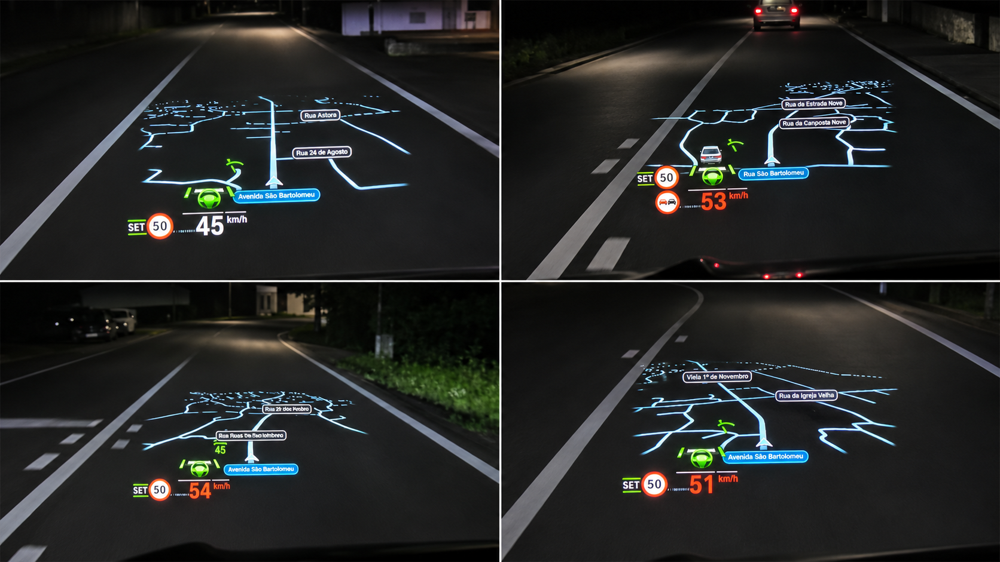

# HUD map (prototype)

A clean road map on the BMW head-up display: the streets around the car, drawn in perspective over the road, with
street names, speed camera points and the car's own position. It is rendered on the head unit through
[cluster-render](../../native/cluster-render), so it sits in the HUD next to BMW's own speed readout, speed limit and
assist icons, which keep showing as before.

*Four photos from the driver's seat at night. The photos were heavily denoised; the HUD itself looks sharper.*

This is a **prototype**: it runs on the car it was developed on (iDrive 7 MGU, P18_23w44.2-1-3) and needs more work
before it is a finished app. See [Known issues](#known-issues).

| Component | |
|---|---|
| [`native/mindflow-hud`](../../native/mindflow-hud) | the HUD map service: road tiles, the HUD scene, camera points |
| `apps/robertn_hud_map` | the iDrive app: settings page (size, position, zoom, horizon, road brightness, camera warnings), and the feed of the car's position and turn guidance to the service |

## Why

The goal was a HUD map that is very clean and looks as close to native as possible. Showing Google Maps or Waze
themselves on the HUD (overlaying and masking their picture) never got there: the result always looked busy and
distracting on a HUD. Drawing our own map from vector road data gives thin, bright road lines on black, which a HUD
shows as floating lines over the road, and nothing else.

Placing the car on such a map from the phone's picture (tracking the position of Google Maps' or Waze's arrow) was also
tried; nothing worked as well as having real geometry to draw.

## How it works

Everything comes from interfaces the head unit publishes to apps over SOME/IP. Nothing patches BMW software, and
nothing reads another process's memory.

1. **Car position.** The app subscribes to BMW navigation's `Positioning` interface: `rawPositionData` (the GNSS fix:
   position, heading, fix type, UTC time) and `currentLocation` (BMW's own map-matched, dead-reckoned position). Without
   a satellite fix (garage, tunnel) the map follows `currentLocation`, so it shows at once when the car starts.
2. **Map.** The service downloads Mapbox Streets vector tiles around the car and ahead of it (Node 8 on the unit, no
   browser), and draws the roads as a perspective scene, oriented to the direction of travel, with the current road's
   name and the names of the streets ahead. The scene goes to cluster-render's HUD target, at most one geometry update
   per part per second (the renderer's limit), with an automatic retry if the renderer ever refuses a frame.
3. **Turn guidance.** When Android Auto navigates, `aapd` converts Google Maps' maneuvers into BMW guidance events and
   pushes them into BMW navigation. BMW's own HUD reads them from the `GuidanceEventList` view `HUD.RB.Main`. The app
   reads the same list, read-only (`getViewConfig`, then `queryContent` every 500 ms like the HUD), and the service
   draws the next maneuver: turn arrow, roundabout exit, distance and road. The HUD map and BMW's own HUD guidance
   share one HUD display slot, so while the map shows, the turn guidance has to come from us.
4. **Network.** The Store refuses internet access for root, so the service, which stays root, opens its HTTPS
   connections through a small helper running as `hmi_5000` (uid 5000, the tool's `"uids"`), and gets the connected
   sockets back.

### The route line, and why there is none yet

What is missing for a navigation map is the **route geometry**: the polyline of the route ahead. Android Auto
projects the next maneuvers to the car (turn, distance, lanes, distance and time to the destination), but not the
route's coordinates and not even the destination's: the projected waypoints arrive with `coordinatesValid: false`.
The route only exists on the phone.

Getting it out of Android Auto or `aapd` directly has been challenging so far. Reading it from `aapd` means
instrumenting a closed binary at addresses that change with every firmware build; it worked in an emulator for one
build and stops at the next. That is why this version takes the approach above: the car's own position and BMW's
own guidance list, both through published interfaces, which survive firmware updates.

**A companion app** on the phone could be an alternative: an Android app that knows the destination (for example by
starting the trip or by sharing the place to it) could compute or receive the route and send its geometry to the
head unit over Wi-Fi. This has not been worked on yet.

## Features

- Road map around the car from Mapbox vector tiles: thin bright lines on black, fading with distance, so only the
  roads float over the road ahead; current road name and the names of the streets ahead.
- The car's position from BMW positioning, with BMW's map-matched position as the fallback without GNSS.
- **Speed camera points**: fixed cameras from OpenStreetMap (regional packs in [Vela](https://github.com/PimpinPumpkin/Vela)'s
  public road-features format, downloaded once and cached on the unit, plus live Overpass queries), matched to the
  direction of travel, with an icon on the map and a warning.
- Settings page in iDrive: on/off, zoom, map size, position (left/right/up/down), viewing distance, horizon, road
  opacity, camera warnings.
- Leaves BMW's own speed, speed limit and assist icons visible.

The possibilities are wide open: the scene is our own, so anything the car or the phone can tell the head unit can
be drawn on it. Turn indications are an example: they are already implemented (the guidance feed and the turn panel
above) but do not show yet, see below.

## Known issues

- **The route line is not drawn.** Without route geometry the service sends the renderer a placeholder, which the
  scene leaves out. Drawing the upcoming streets of the route (for example from the maneuver points) should be an
  easy fix.
- **Turn indications** are implemented but not yet working on the car.
- **Speed camera data over Overpass**: `overpass-api.de` refuses the TLS of the unit's Node 8, so only the regional
  packs work there.
- The map uses one public Mapbox token, shipped in `native/mindflow-hud/mapbox.json`. A private
  `mindflow-hud-routing` tool (`/var/opt/mindflow-hud-routing/current/routing.json`, `{"mapbox_token": "pk..."}`)
  overrides it.
- Tested on one car (G-series, iDrive 7, HUD). Positions, sizes and timings are tuned by eye.

## License

GPL-3.0-or-later (`LICENSE`). The build script is the one from `apps/robertn_waze_cluster`. Vendored npm modules in
`native/mindflow-hud/vendor` keep their own licenses (BSD-3-Clause, MIT, ISC).
